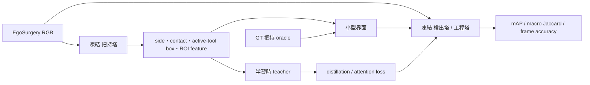
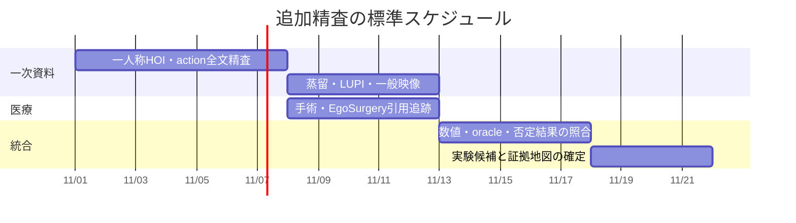

# 把持関係を補助信号として使う手法の文献調査報告

## エグゼクティブサマリー

**結論から言うと、「独立に学習・凍結した手–物体相互作用モデルの出力を、下流の物体理解または行動・手順認識に渡して改善する」という発想と非常に近い先行研究は見つかった。** とくに重要なのは、ECCV 2026 の **VidParse** である。これは凍結した hand–object detector から得た相互作用領域を使って、凍結 DINOv2 の特徴をその領域だけから集約し、**online の手順解析**に用いる。EgoPER 上で full-frame DINOv2 の Accuracy 69.09 / F1@0.5 61.42 に対し、interaction-box に限定した表現では 80.69 / 77.61 まで上昇している。したがって、依頼文の分類では **(a) 推論時に把持モデル出力を渡す S1 に最も近い既発表例**である。ただし、VidParse の受け取り側は学習済み工程分類器ではなく、プロトタイプ照合＋グラフ制約デコーダであり、EgoSurgery の想定と完全同型ではない。 citeturn436789academia5turn436789search0

学習時だけ手・物体情報を使い、推論時は RGB のみに戻す **(b) S2 型**にも強い根拠がある。**Helping Hands** は off-the-shelf の 100DOH detector が生成した手・物体 box を訓練時の疑似教師として使用し、推論時には RGB のみを入力する。**Multimodal Distillation for Egocentric Action Recognition** は object detections 等を持つ multimodal teacher から RGB-only student へ蒸留し、EPIC-KITCHENS と Something-Something で単純な単一モダリティ学習より高精度かつ良好な calibration を報告している。したがって **「把持塔を教師にし、工程塔・検出塔は推論時に把持塔を必要としない」設計には直接的な方法論上の先例がある。** citeturn573214search9turn539536search3

一方、**EgoSurgery-HTS の把持出力を EgoSurgery の工程認識または術具検出の補助として利用した既発表研究は、今回確認できた範囲では見つからなかった。** EgoSurgery-HTS 本体は hand / tool / hand-tool segmentation のベンチマークであり、下流の phase recognition や tool detection への補助利用までは実験していない。EgoSurgery 系では、工具や組織の空間情報を workflow recognition に入れて精度向上を示す研究はあるため、「術具情報が工程認識に効く」こと自体には先例があるが、「独立した把持塔の推論を渡す」という点は未充足である。 citeturn153721search0turn576680search2

この点は研究上かなり重要である。依頼文の制約、すなわち「検出塔・工程塔は各自のラベルだけで学習し、把持ラベルを直接混ぜず、第三の把持塔だけから情報を受ける」という設定は fileciteturn0file0、既存の end-to-end multi-task HOI/action モデルとは明確に異なる。最も証拠が強い順に試すなら、**S1 は `interaction ROI / active-tool box → 小型界面 → 工程塔`、S2 は `把持塔特徴または logits → distillation / attention teacher`** が優先候補になる。

## 調査範囲と方法

今回の探索では、一人称非手術映像を最優先にし、一般映像の物体中心 action reasoning、蒸留・特権情報、最後に手術映像を確認した。主要な一次資料として CVF Open Access、arXiv、PubMed、出版社・公式プロジェクトページを優先し、100DOH、EPIC-KITCHENS、MECCANO、Assembly101、EgoPER、HoloAssist、HOI4D、EgoSurgery 系を起点として citation chaining を行った。100DOH は手の位置、左右、contact state、接触物体 box を同時推論する代表的な HOI 表現で、100K の hand-contact annotation を持つため、この系統の off-the-shelf teacher の基準点として有用である。 citeturn110383search0

検索式は、単に `"hand object interaction action recognition"` とするだけでなく、設計条件を明示的に組み合わせた。再現用の代表例は `("egocentric" AND "hand-object" AND action recognition AND frozen detector)`、`("active object" AND egocentric AND action anticipation)`、`("hand object" AND privileged information AND action recognition)`、`("hand-object detector" AND online procedure parsing)`、`("surgical phase" AND hand AND tool interaction)`、`("EgoSurgery-HTS" AND phase)` である。Google Scholar、arXiv、IEEE Xplore、PubMed、CVF、公式研究室サイトを横断するのが適切で、医療系については PubMed と出版社 DOI を優先するのが再確認には向いている。 citeturn576680search0turn576680search4

文献の信頼度は本報告独自の **5 点尺度**で評価した。5 は査読済み一次論文かつ本文と定量実験を確認、4 は査読論文だが本問いへの検証が間接的、3 は新しい preprint やワークショップで再現性・追試が限定的、という意味であり、論文自体の学術的「品質点」ではない。

## 主要な証拠地図

| 文献 | 種別・年 | 手・相互作用の表現と使い方 | 主な結果 | 信頼度 | 本研究への関連度 |
|---|---|---|---|---:|---:|
| **VidParse** | ECCV 2026 | 凍結 hand–object detector の interaction box で、凍結 DINOv2 patch features を ROI pooling。online 手順解析 | EgoPER: full-frame DINOv2 Acc 69.09→MAF 80.69、F1@0.5 61.42→77.61 | 5/5 | **5/5** citeturn436789search0 |
| **Helping Hands** | ICCV 2023 | 100DOH の noisy hand/object box を**訓練時のみ**教師に利用。推論は RGB のみ | object-aware representation が retrieval / classification / grounding を改善 | 5/5 | **5/5** citeturn539536search9turn573214search9 |
| **Multimodal Distillation for EAR** | ICCV 2023 | object detection 等を持つ multimodal teacher → RGB-only student | EPIC-KITCHENS / Something-Something で student が同等構造の通常学習より高精度・良 calibration | 5/5 | **5/5** citeturn539536search3 |
| **Shiota et al., HOCL/OSL** | WACV 2024 | hand-object contact と object state を補助学習 | 最大 +2.24 pp EGTEA、+3.97 pp MECCANO、+1.49 pp EPIC-KITCHENS-100 | 5/5 | **4.5/5** citeturn539536search0 |
| **EgoPER error detection** | CVPR 2024 | active-object detection → relation graph → GCN、action segmentation / error detection | holistic feature に object-relation feature を加える設計で SOTA を上回る | 5/5 | **4.5/5** citeturn110383search3 |
| **AssemblyHands** | CVPR 2023 | 左右手を含む高品質 3D hand pose を action classification に利用 | hand-pose 精度の向上が action recognition 精度向上に直接結びつく | 5/5 | **4/5** citeturn110383search4 |
| **STIN / Something-Else** | CVPR 2020 | agent・object box の sparse graph と tracklet を時空間 reasoning | compositional / few-shot action recognition に有効 | 5/5 | **4/5** citeturn539536search2turn539536search11 |
| **EgoSurgery-HTS** | HTL 2025 | hand / tool / interacting-tool pixel masks | segmentation benchmark。工程・術具検出への補助利用は未報告 | 5/5 | **5/5（データ）** citeturn153721search0 |

この表から見える最も強い傾向は、**「手や把持の mask そのもの」より、「どこが active interaction region なのかを特定し、その領域の高次特徴を抽出する」使い方の方が、下流モデルとの結合が容易**という点である。VidParse はその最も直接的な実証例であり、EgoPER の同一デコーダ条件で interaction-region pooling が full-frame feature を大幅に上回っている。これは、EgoSurgery-HTS で SAM mask と box overlap の整合性に限界があるという依頼背景を考えると、pixel mask を直接渡すより **box / active-tool identity / ROI feature を界面表現にする**方が頑健である可能性を示す。ただしこれは EgoSurgery での実証ではなく、類似条件からの推論である。 citeturn436789search0

## 問い別の知見とギャップ

**行動・工程認識への利用。** 手・物体の位置だけでも行動情報を持つことは古くから確認されている。Kapidis らは手と物体の検出位置系列だけで egocentric action classification が可能であることを示し、Bambach らは ground-truth hand segmentation のみで 66.4% の frame classification、automatic segmentation では 50.9% と報告しており、**HOI推論誤差が下流性能を実際に劣化させる**ことも明示している。後者では ground-truth hand mask と自動 mask の差が約 15.5 percentage points あり、今回の「把持塔の精度と下流利得の関係」を調べる上で重要な precedent である。 citeturn539536academia12turn573214search7

より近年では、HOCL/OSL が contact と object-state を補助教師として action model に組み込み、EGTEA、MECCANO、EPIC-KITCHENS-100 の全てで改善を示した。とくに MECCANO で最大 3.97 points の改善があり、少数サンプル・未知環境でも利得が出たと報告されているため、動画数が少ない EgoSurgery に対しては有望な類例である。ただしこれは独立 frozen HOI tower ではなく collaborative / auxiliary learning なので、S1 より S2 の設計根拠に近い。 citeturn539536search10

**active object と物体理解。** MECCANO は action segment と active-object box の両方を持ち、action recognition、active-object detection、active-object recognition、HOI detection を同一データ上で定義しているため、問い (2)(7) の最重要 benchmark の一つである。EPIC-KITCHENS でも hand observations を利用して active objects を局所化・安定化し、object state や affordance を学習できることが示されている。next-active-object 系では Furnari らが object trajectory から「次に触る物体」を予測し、その後 Ego4D STA では StillFast や NAOGAT が active object、verb、time-to-contact を同時に予測する方向へ発展している。 citeturn110383search1turn798326search2turn624612academia13turn624612search8turn624612search9

ただし、「HOI推論を入れたことで mAP が特に小物体・希少クラス・紛らわしい物体で上がった」という、EgoSurgery の術具検出にそのまま移植できる class-wise ablation は、今回確認できた主要文献では少ない。手術領域では **Hand Motion-Aware Surgical Tool Localization and Classification** が、形状の似た scissors / needle holder 等の識別で hand/tool motion を利用する問題設定を扱っており、この方向が最も近い。 citeturn576680search1

**凍結モデル対 multi-task。** H+O、H2O、Wen らの階層 temporal transformer は手姿勢・物体姿勢・action を共同で学習する代表例で、HOI の幾何表現自体が action recognition に有用であることを示す。一方、VidParse は frozen hand-object detector、Helping Hands は frozen encoder と外部 detector supervision を使うため、「相互作用モデルを切り離す」側の代表になる。しかし、**同じデータ・同じ backbone・同じ評価指標で frozen-transfer と joint multi-task を直接比較した研究は少なく、ここは明確な文献ギャップ**である。 citeturn539536search5turn624612search12turn539536search7turn436789search0

**推論時に使わない利用。** Helping Hands と multimodal distillation が最も明確で、依頼の S2 に近い。これは、把持塔が推論時の計算量・failure mode を増やすことを避けつつ、把持知識を受け取り手に残す設計である。とくに EgoSurgery のように 15 動画程度で fold ごとの分散が大きくなりうる設定では、「S1 で実利があるか」「S2 で同等の利得を残せるか」を同じ split で比較する価値が高い。後半は本研究への設計提案であり、既報値そのものではない。 citeturn539536search3turn573214search9

**左右・両手。** 100DOH は handedness を明示し、H2O は left/right の 3D hand pose と object pose、interaction label を持つ。Assembly101 / AssemblyHands は両手の 3D hand trajectories を大規模に持ち、EgoExoLearn は fine action description に「どちらの手を使ったか」を明示的に付与している。したがって、EgoSurgery-HTS の「左手・右手・両手で持つ術具」という区別には十分な先例がある。ただし「left/right を潰した場合と区別した場合の phase 認識差」を直接 quantify した文献は今回の主要集合では確認できず、独自 ablation として価値がある。 citeturn110383search0turn624612search12turn110383search2turn798326search10

**online 制約。** VidParse は明確に online で、各フレームを一度だけ処理し、temporal similarity のために有限 window を保持する。これは今回の工程塔の causal 条件と特に近い。さらに 2026 年の industrial HOI system は streaming 30 fps で contact state が発生した時だけ object detector を起動する cascade を採用しており、「相互作用状態を gating signal として下流処理を制御する」という別の S1 型設計を示す。 citeturn436789search0turn573214search3

**否定的結果・強い backbone。** 手情報が常に効くわけではない。2026 年の DEHOI 研究は、強い egocentric video-language model であっても hand / object cue の片方や背景相関に shortcut することを示し、手・物体 cue を明示的に学習させる余地が残ると報告している。一方で VidParse の feature comparison では、interaction anchoring の利得は backbone に依存し、EgoVLPv2 の clip representation より DINOv2 frame representation の方が強かった。したがって「receiver が強くなるほど把持信号が不要になる」という単純な関係ではなく、**HOI 信号の表現と挿入位置との相互作用を測る必要がある。** citeturn693223academia5turn436789search0

## EgoSurgery への設計判断

現時点の証拠から最優先に検証すべき S1 は、**把持 mask の raw pixel map をそのまま融合する方式ではなく、`left/right/contact/active-tool box + ROI feature` を低次元化して工程塔・検出塔へ渡す方式**である。100DOH が side・contact・active-object box を標準的表現として採用し、VidParse が interaction region を直接 feature extraction の空間 prior にすることで大きな利得を出しているからである。 citeturn110383search0turn436789search0

工程認識では、まず `RGB工程塔`、`RGB + active-tool box/side/contact`、`RGB + interaction-ROI feature`、`RGB + oracle GT interaction` の四条件を同じ 5-fold split で比較するのがよい。**oracle と predicted の差**は把持塔精度がボトルネックかどうかを直接示し、Bambach らの「GT hand segmentation 66.4% 対 automatic 50.9%」のような解析と対応する。online 性を守るため、時刻 \(t\) の工程分類に同じフレームの把持結果を使う条件と、\(t-1\) までしか使わない厳格 causal 条件を分けるべきである。後者は本研究特有の実験提案である。 citeturn573214search7turn436789search0

S2 では、最初から複雑な feature distillation に進むより、**把持塔の active-tool/contact logits を auxiliary teacher とする KL / feature matching**、次に **interaction ROI を attention teacher とする方式**を試すのが合理的である。Helping Hands が noisy detector box でも supervision として利用できたことは、SAM 由来 mask や box-overlap による把持判定が完全でなくても、teacher signal としては実用価値がありうることを示唆する。ただし EgoSurgery-HTS のノイズ構造は異なるため、これは外挿であり、mask 品質と下流利得を fold 内で明示的に測る必要がある。 citeturn573214search9

検出側では、まず「全術具 mAP」だけでなく、**hand-held / non-held、rare / frequent、small / large、形状混同群**に分けるべきである。既存手術研究は、open surgery では似た形状の術具や tip occlusion が問題になる一方、hand/tool motion は比較的観測しやすいことを指摘しており、把持信号が最も効きやすいのはこの群である可能性がある。 citeturn576680search1

研究フローは次の形が最も再現性を確保しやすい。

ここで S1 と S2 を同一 split、同一 receiver、同一計算予算で比較することが、既存文献で不足している **frozen-transfer 対 learning-only-transfer** の直接比較になる。

## 優先文献・追加調査計画・成果物

追加調査を進める場合、優先順位は **VidParse → Helping Hands → Multimodal Distillation → HOCL/OSL → EgoPER → 100DOH → MECCANO → AssemblyHands/H2O → surgical hand/tool studies → EgoSurgery-HTS の引用追跡**がよい。上位五本だけで、S1、S2、online、interaction ROI、noisy pseudo-label、少数データに関する主要仮説の大半を覆える。 citeturn436789search0turn539536search9turn539536search3turn539536search0turn110383search3

2–4 週間の精査工程に落とすなら、前半で一次論文の full-text extraction と数値・ablation の照合、中盤で dataset × representation × downstream task の証拠表を完成させ、後半で EgoSurgery に移植可能な S1/S2 の実験カードへ落とすのがよい。現時点で特に残っている検索課題は、**HOI 精度と下流利得を連続的に相関分析した研究、GT-vs-predicted HOI oracle gap、class-wise object detection gain、左右・両手 ablation、frozen と joint multi-task の直接比較**である。これらは今回の検索でも断片的な報告に留まった。

最終成果物として残すべきものは、**文献ごとの事実表、表現系統表、dataset 対応表、S1/S2 比較表、oracle gap 表、否定結果表、そして EgoSurgery 用の実験優先順位**である。とくに表現系統は `box → mask → contact state → side → pose/3D → graph → semantic feature` と分け、各表現が「検出」「action recognition」「temporal segmentation」「anticipation」のどれで効いたかを分離すると、把持塔 M v3.3 の出力のどこを界面に残すべきかを判断しやすい。100DOH、STIN、H2O、AssemblyHands、VidParse はそれぞれこの表現軸の異なる点を代表する。 citeturn110383search0turn539536search2turn624612search12turn110383search4turn436789search0

現時点の最も重要な判断は、**「同じ形の研究は完全一致ではないが、工程側 S1 には VidParse という非常に近い先例があり、S2 には Helping Hands と multimodal distillation という強い先例がある。EgoSurgery-HTS を直接この用途に使った既報は確認できない」**というものである。したがって、新規性を守りつつ既存知見を最大限利用するには、まず **interaction ROI / active-tool identity を用いる S1** と、**同じ信号を学習時だけ蒸留する S2** の対照実験を中心に据えるのが最も証拠に沿った選択である。 citeturn436789search0turn539536search3turn573214search9turn153721search0